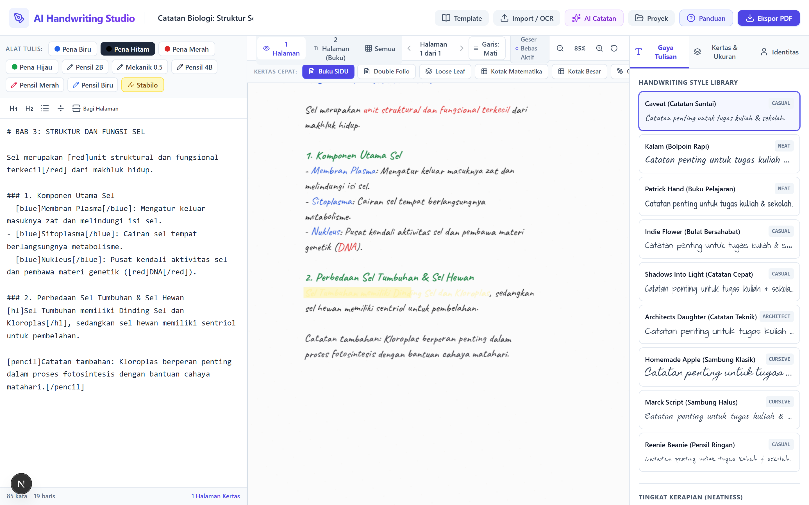
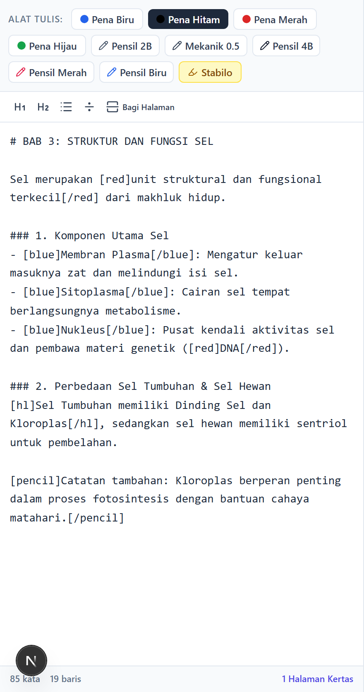
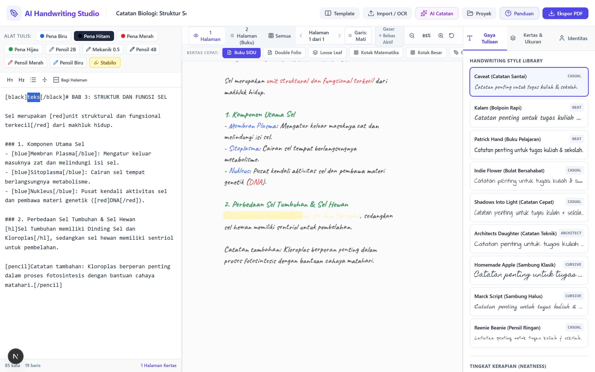
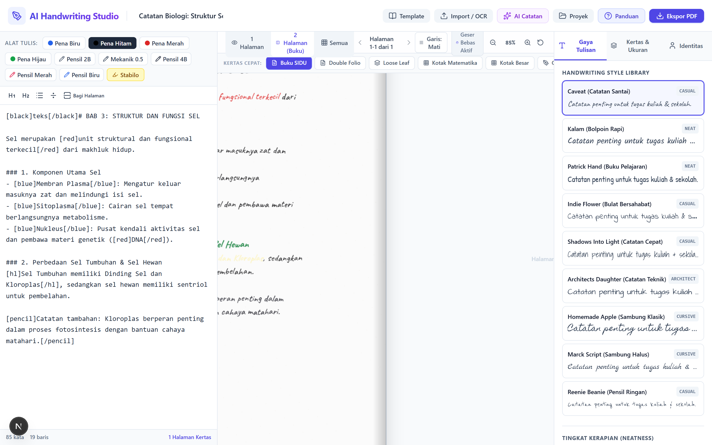
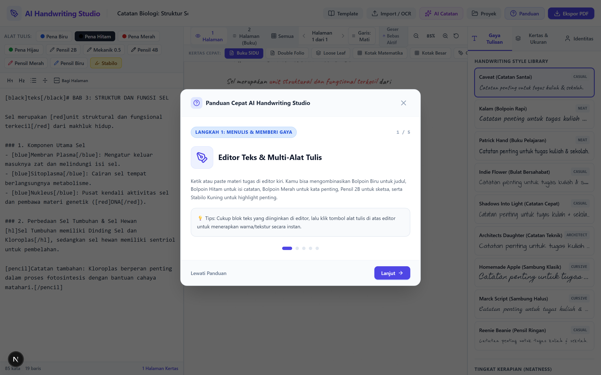
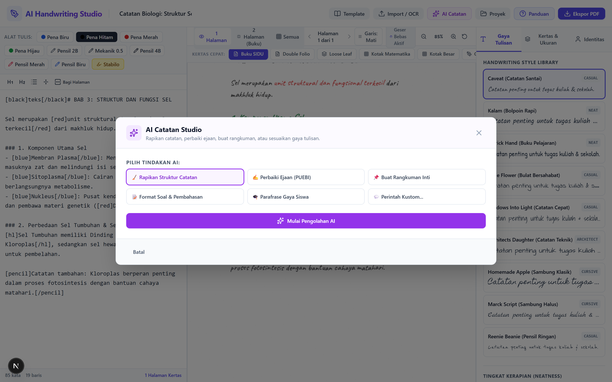
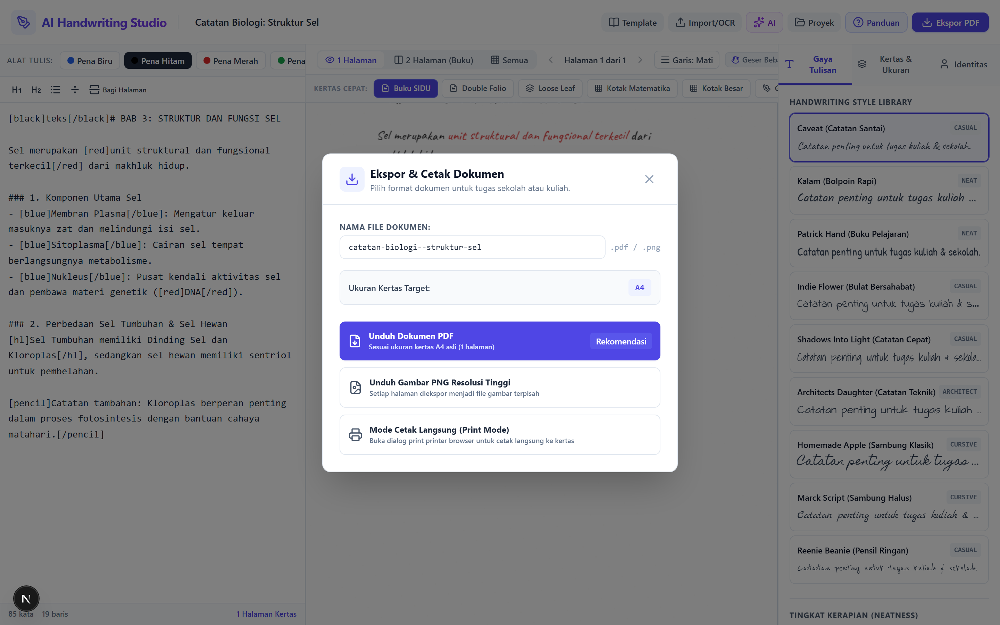
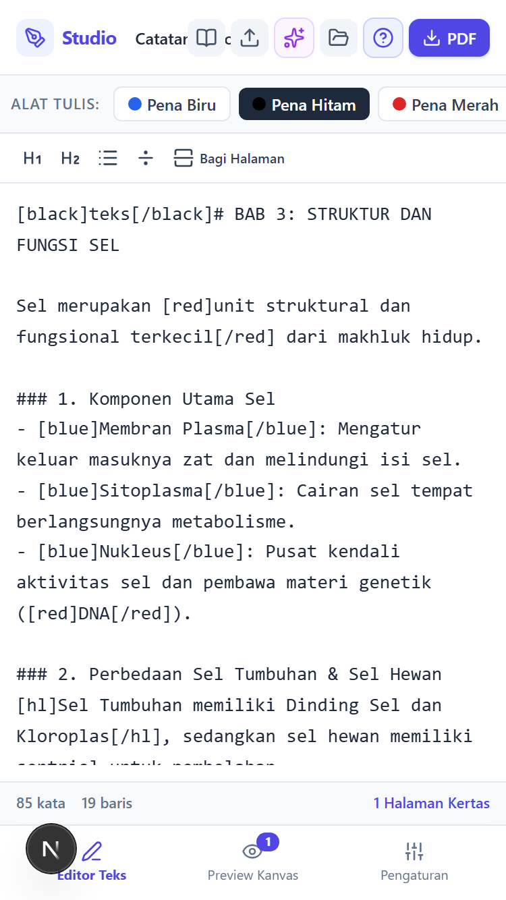
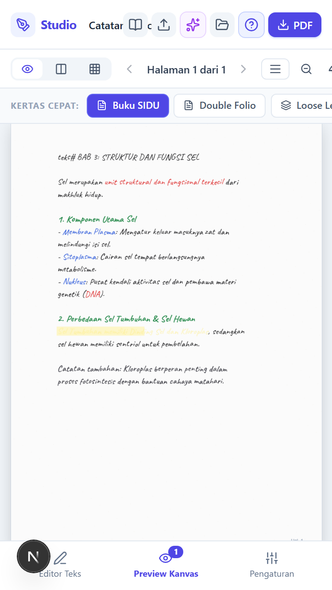
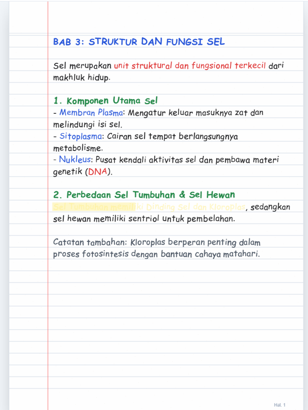

# AI Handwriting Studio ✍️

> **Studio Tulisan Tangan Digital Interaktif untuk Pelajar, Mahasiswa, Guru, dan Dosen.**  
> Mengubah teks, catatan pelajaran, tugas kuliah, rangkuman, dan jawaban soal menjadi simulasi tulisan tangan digital yang realistis pada berbagai jenis buku tulis bergaris, folio, loose leaf binder, kotak matematika, dan lembar ujian resmi.

---

## 📸 Bagian-Bagian Penting Aplikasi & Contoh Tata Cara Penggunaan

Berikut adalah tangkapan layar bagian-bagian utama studio beserta panduan cara menggunakannya dengan benar:

### 1. Tampilan Workspace Studio Utama (3-Pane Workspace)

- **Panel Kiri (Editor)**: Tempat mengetik atau menempel materi catatan, mengatur alat tulis, dan memasukkan rumus matematika.
- **Panel Tengah (Kanvas Kertas)**: Preview tulisan tangan secara *real-time*. Dilengkapi kontrol zoom dan kursor geser bebas (*drag-to-pan*).
- **Panel Kanan (Sidebar Pengaturan)**: Pilihan gaya font tulisan tangan, ukuran huruf, kemiringan, jenis kertas, serta identitas siswa.

---

### 2. Editor Teks & Toolbar Multi-Alat Tulis


#### 📝 Cara Menggunakan:
1. Ketik catatan atau tempel (*paste*) materi dari dokumen lain di area teks.
2. **Memberi Warna & Efek Alat Tulis**:
   - Blok teks yang ingin diubah, lalu klik tombol alat tulis di toolbar atas:
     - 🔵 **Pena Biru (`[blue]...[/blue]`)**: Standar untuk Judul Bab atau Sub-judul.
     - ⚫ **Pena Hitam (`[black]...[/black]`)**: Standar untuk seluruh isi materi catatan.
     - 🔴 **Pena Merah (`[red]...[/red]`)**: Untuk istilah penting, kata kunci, rumus, atau koreksi guru.
     - 🟢 **Pena Hijau (`[green]...[/green]`)**: Untuk sub-poin atau klasifikasi materi.
     - ✏️ **Pensil 2B (`[pencil]...[/pencil]`)**: Untuk catatan kecil/sketsa dengan efek grafit realistis.
     - 🖊️ **Pensil Mekanik 0.5mm (`[pencil-mech]...[/pencil-mech]`)**: Goresan sangat tipis, tajam, dan rapi.
     - 🖍️ **Pensil 4B Gelap (`[pencil-4b]...[/pencil-4b]`)**: Goresan empuk, tebal, dan berbutir.
     - 🖍️ **Pensil Warna Merah / Biru (`[pencil-red]` / `[pencil-blue]`)**: Untuk diagram & grafik.
     - 🟡 **Stabilo Kuning (`[hl]...[/hl]`)**: Menandai kalimat penting yang wajib dihafal.
3. **Format Khusus**:
   - Judul Bab: Ketik `# ` di awal baris.
   - Sub-judul: Ketik `### ` di awal baris.
   - Rumus Matematika: Masukkan di antara tanda dolar, contoh: `$x = \frac{-b \pm \sqrt{b^2-4ac}}{2a}$`.
   - Pemisah Halaman: Masukkan tanda `---` untuk berpindah ke halaman kertas berikutnya.

---

### 3. Quick Paper Bar & Kustomisasi Garis Kertas


#### 📐 Cara Menggunakan:
1. **Ganti Kertas Cepat**: Klik tombol kertas pada bar horizontal di atas kanvas:
   - **Buku SIDU**: Garis biru sekolah dengan garis tepi merah kiri.
   - **Double Folio**: Format standar tugas sekolah & kuliah (garis tepi ganda merah di kiri dan tepi kanan).
   - **Loose Leaf**: Kertas binder kampus bergaris lengkap dengan 26 lubang ring binder.
   - **Kotak Matematika**: Grid 5mm untuk perhitungan rumus dan angka.
   - **Kotak Besar**: Grid 10mm untuk latihan anak SD & aksara/hanzi.
   - **Garis 3 Halus**: Format belajar menulis halus & tegak bersambung.
   - **Lembar Ujian**: Tabel formal Nama, Kelas, Mapel, Tanggal, dan Nilai.
   - **Milimeter Blok**: Kertas grafik oranye presisi untuk gambar teknik & fisika.
   - **Not Balok**: Garis paranada (*stave lines*) untuk catatan musik.
   - **Polos Ivory**: Kertas bersih tanpa garis untuk catatan bebas.
2. **Menyembunyikan / Menampilkan Garis**:
   - Jika garis mengganggu, klik tombol **`Garis: Mati`** pada toolbar atas untuk menghilangkan garis buku secara instan.
3. **Mengatur Warna & Kepekatan Garis**:
   - Buka tab **Kertas & Ukuran** di sidebar kanan.
   - Pilih warna garis (Biru SIDU, Abu-abu Minimalis Kokuyo, Cokelat Sepia Moleskine, Hijau Sains, dll).
   - Atur slider **Kepekatan Garis (Opasitas)** dari 10% (sangat samar) agar tidak mengganggu tulisan tangan.

---

### 4. Mode Tampilan 2 Halaman (Buku Terbuka) & Kursor Geser Bebas


#### 🖐️ Cara Menggunakan:
1. **Mode 2 Halaman**: Klik tombol **`2 Halaman (Buku)`** di bar atas untuk melihat catatan seperti buku tulis terbuka berdampingan lengkap dengan efek bayangan lipatan tengah (*spine shadow*).
2. **Kursor Geser Bebas (*Drag-to-Pan*)**:
   - Klik dan tahan mouse di mana saja pada area kanvas, lalu geser (*drag*) untuk memindahkan kertas secara leluasa ke posisi yang nyaman.
3. **Zoom & Reset**:
   - Gunakan tombol `+` dan `-` untuk memperbesar atau memperkecil.
   - Klik tombol **Reset Posisi & Zoom** (`RotateCcw`) untuk mengembalikan kertas ke tengah dengan zoom 85%.

---

### 5. Panduan Cepat Interaktif (Quick Guided Tour)


#### 💡 Cara Menggunakan:
- Pengguna baru akan disambut oleh panduan cepat 5 langkah ini secara otomatis saat pertama kali membuka aplikasi.
- Untuk membukanya kembali kapan saja, klik tombol **`Panduan`** (`HelpCircle`) di navbar atas.
- Gunakan tombol panah keyboard (`←` dan `→`) atau tombol *Lanjut* untuk menelusuri fitur utama.

---

### 6. Asisten AI Catatan Studio & Import Dokumen / OCR


#### 🤖 Cara Menggunakan AI Catatan:
1. Klik tombol **`AI Catatan`** berikon bintang ungu di navbar atas.
2. Pilih tindakan otomatis yang diinginkan:
   - 🧹 **Rapikan Struktur Catatan**: Mengubah teks acak menjadi susunan bab dan poin rapi.
   - ✍️ **Perbaiki Ejaan (PUEBI)**: Membetulkan typo, huruf kapital, dan tanda baca otomatis.
   - 📌 **Buat Rangkuman Inti**: Meringkas materi panjang menjadi poin-poin hafalan.
   - 📝 **Format Soal & Pembahasan**: Menyusun soal latihan lengkap dengan langkah jawaban.
   - 🎓 **Parafrase Gaya Siswa**: Menuliskan kembali kalimat dengan gaya bahasa catatan santai.
3. Bandingkan hasil pada panel *Teks Asli* vs *Hasil AI*, lalu klik **Gunakan Hasil Ini di Editor**.
4. *Catatan*: Fitur AI memiliki sistem pemrosesan lokal cerdas (*heuristic offline fallback*) sehingga tetap berfungsi lancar tanpa memerlukan API key eksternal.

#### 📷 Cara Menggunakan Import Dokumen / OCR Multi-Bahasa:
1. Klik tombol **`Import / OCR`** di navbar atas.
2. Pilih tab **Dokumen** untuk mengunggah file `.docx` (Microsoft Word) atau file teks `.txt`.
3. Pilih tab **OCR Gambar** untuk mengunggah foto soal dari lembar tugas atau foto papan tulis.
4. **Pilih Bahasa OCR Dunia**: Tersedia 12 bahasa utama:
   - 🇮🇩 Bahasa Indonesia (`ind`)
   - 🇬🇧 English (`eng`)
   - 🌐 Campuran Indo + English (`ind+eng`)
   - 🇸🇦 Arabic / Bahasa Arab (`ara`)
   - 🇨🇳 Mandarin / Chinese Simplified (`chi_sim`)
   - 🇯🇵 Japanese (`jpn`)
   - 🇰🇷 Korean (`kor`)
   - 🇫🇷 French (`fra`)
   - 🇪🇸 Spanish (`spa`)
   - 🇩🇪 German (`deu`)
   - 🇷🇺 Russian (`rus`)
   - 🇵🇹 Portuguese (`por`)
5. Tesseract OCR akan mengekstrak tulisan menjadi teks otomatis lengkap dengan progress bar.

---

### 7. Dialog Ekspor Dokumen & Siap Cetak


#### 🖨️ Cara Mengunduh & Mencetak:
1. Klik tombol biru **`Ekspor PDF`** di pojok kanan atas.
2. Sesuaikan nama file dokumen yang diinginkan.
3. Pilih format output:
   - **Unduh Dokumen PDF**: Menghasilkan file PDF resmi multi-halaman sesuai ukuran fisik kertas asli (A4, A5, Folio/F4, Letter, B5) siap dikumpulkan ke guru atau dosen.
   - **Unduh Gambar PNG Resolusi Tinggi**: Mengekspor setiap halaman menjadi gambar tajam (300 DPI equivalent) untuk dibagikan via WhatsApp atau Google Classroom.
   - **Mode Cetak Langsung (Print Mode)**: Membuka jendela print printer komputer Anda.

---

### 8. Desain Responsif di Semua Perangkat (Mobile, Tablet, & Desktop)
<p align="center">
  
  &nbsp;&nbsp;
  
</p>

*Aplikasi otomatis menyesuaikan ukuran layar:*
- **Smartphone & Tablet**: Menggunakan **Bottom Navigation Bar** yang praktis untuk berpindah cepat antara **Editor Teks**, **Preview Kanvas**, dan **Pengaturan**. Zoom kanvas otomatis disesuaikan agar pas di layar ponsel tanpa terpotong.
- **Laptop & Desktop**: Menggunakan tata letak profesional **3-Pane Workspace** berdampingan secara simultan.

---

### 9. Contoh Hasil Akhir Tulisan Tangan Digital


---

## 🛠️ Arsitektur & Teknologi

- **Frontend Framework**: Next.js 16 (App Router), React 19, TypeScript.
- **Styling**: Tailwind CSS dengan tema adaptif untuk kertas dan tinta bolpoin.
- **Rendering Engine**: HTML5 Canvas rendering dengan PRNG Mulberry32 deterministik, mensimulasikan goresan tinta, variasi kemiringan (*slant*), variasi garis dasar (*baseline jitter*), variasi ukuran karakter, dan tekstur grafit pensil.
- **Handwriting Fonts**: 27 font tulisan tangan Google Fonts yang dikelompokkan ke dalam kategori Rapi, Santai/Kuliah, Sambung Klasik, Balok Gambar Teknik, dan Pensil.
- **OCR Engine**: Tesseract.js (Client-side Web Worker, mendukung 12 bahasa dunia: Indonesia, English, Arabic, Chinese, Japanese, Korean, French, Spanish, German, Russian, Portuguese, dan Campuran).
- **Document Parser**: Mammoth.js (ekstraksi file docx).
- **Math Engine**: KaTeX untuk pemrosesan notasi matematika.
- **PDF Engine**: jsPDF dengan pemetaan dimensi milimeter presisi ukuran kertas internasional dan nasional (F4).
- **Penyimpanan**: LocalStorage dengan debounced auto-save.

---

## 📦 Panduan Instalasi & Menjalankan

### Prasyarat
- Node.js >= 18.x
- npm atau pnpm

### 1. Kloning Repository
```bash
git clone https://github.com/0xyz-exe/ai-handwriting-studio.git
cd ai-handwriting-studio
```

### 2. Instalasi Dependensi
```bash
npm install
```

### 3. Menjalankan Server Development
```bash
npm run dev
```
Buka browser pada alamat: **`http://localhost:3000`**

### 4. Menjalankan Pengujian Otomatis (Automated Tests)
```bash
npm test
```

### 5. Build Produksi
```bash
npm run build
npm start
```

### 6. Menjalankan dengan Docker Compose
```bash
docker compose up -d
```
Aplikasi akan aktif di `http://localhost:3000`.

---

## 📄 Lisensi

Proyek ini dirilis di bawah lisensi open-source [ISC](LICENSE).  
Aset font menggunakan font open-source dari Google Fonts dengan lisensi SIL Open Font License (OFL).
